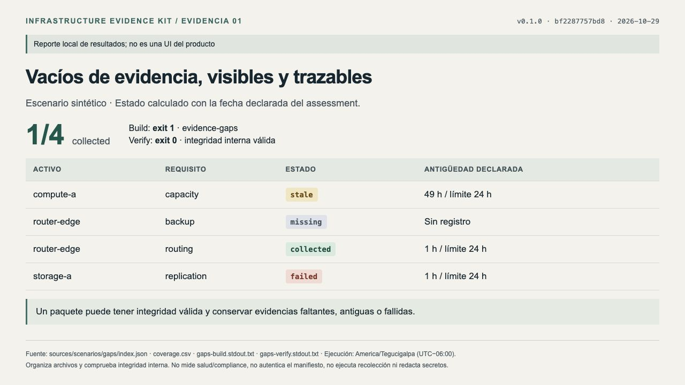
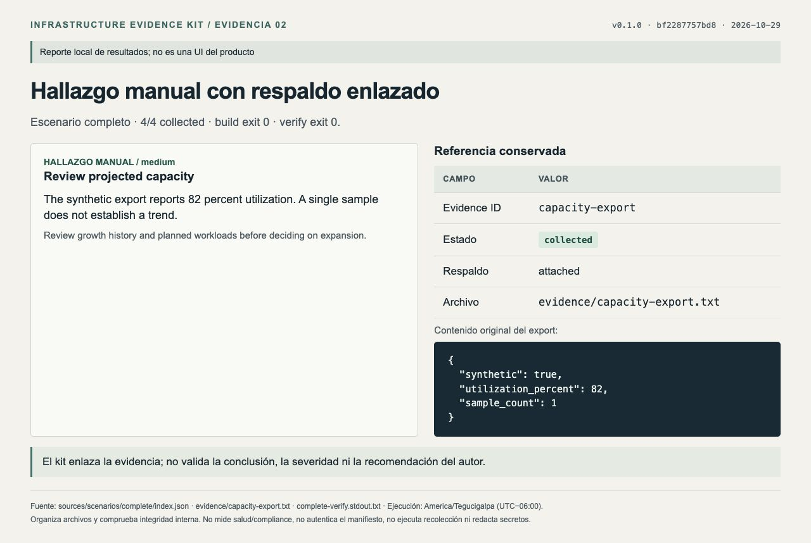
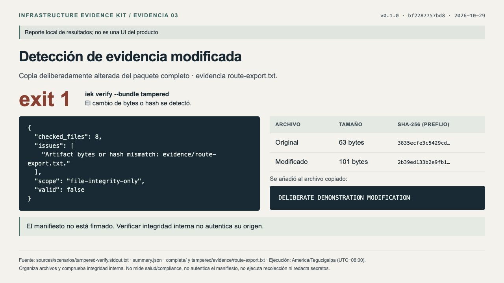
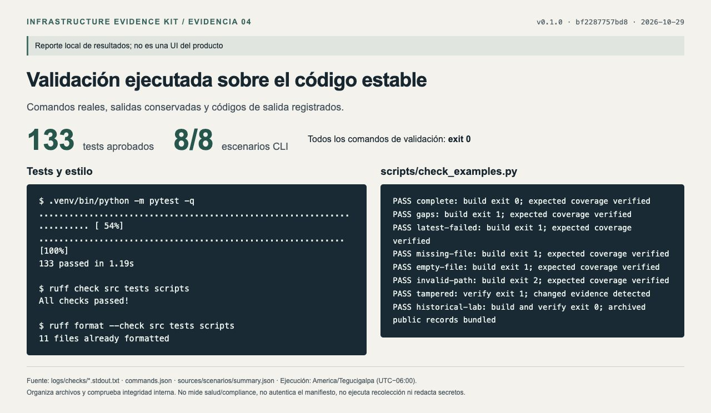
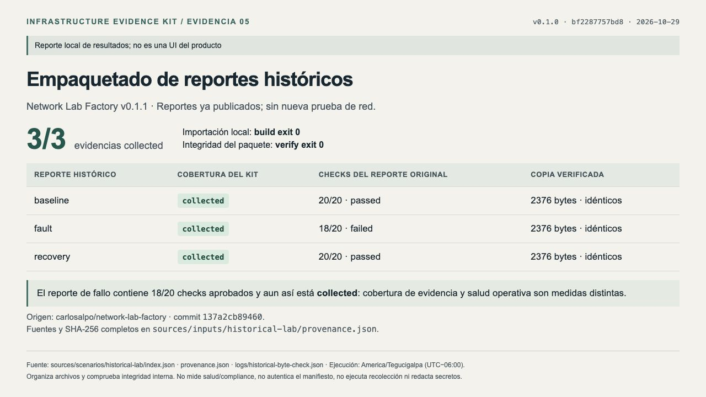

# Test capture gallery

Captured **2026-10-29**, America/Tegucigalpa, using v0.1.0 code commit [`bf22877`](https://github.com/carlosalpo/infrastructure-evidence-kit/commit/bf2287757bd86cf590c89d91f39a5b52abcded43).

These are real browser captures of static local reports populated from executed commands and generated files. They are **not a product dashboard or a live infrastructure interface**. All five images were visually reviewed. The underlying run passed **133 tests and eight CLI scenarios**, plus lint and formatting.

The package retains [command records](commands.json), [logs](logs/), [scenario outputs](sources/scenarios/), [input fixtures](sources/inputs/), [HTML report sources](reports/), a [provenance manifest](manifest.json) and a [SHA-256 inventory](SHA256SUMS). Earlier attempts and temporary test directories were excluded.

## 1. Collection gaps, with explicit states

The synthetic gap assessment has 1/4 collected checks. Build exits 1 for collection gaps while verification exits 0 for internally consistent package bytes. These are different results with different meanings.

## 2. A manual finding linked to its evidence

The complete example has 4/4 collected checks and a manual capacity observation linked to the original export. The kit preserves that reference; it does not validate the author's conclusion or severity.

## 3. Detecting modified evidence

A deliberate modification changes the copied routing export from 63 to 101 bytes. Verification returns exit 1 and identifies the artifact. The manifest is unsigned: internal consistency does not authenticate origin.

## 4. Tests and executable scenarios

Actual local output from the final installed code: 133 passing tests, eight expected scenario outcomes, lint and formatting passed. [CI also passed on Python 3.11, 3.12 and 3.13](https://github.com/carlosalpo/infrastructure-evidence-kit/actions/runs/40941599326).

## 5. Packaging historical public reports

Three already-public reports from Network Lab Factory v0.1.1 are retained byte for byte. One report records failed network checks and still counts as collected evidence. There was **no new network or device test**. [Original source references and hashes](sources/inputs/historical-lab/provenance.json) are included.

## Reuse and verification

Images **01 and 03** are selected for the portfolio. Preserve their scope captions. The repository's separate concept illustrations are not test evidence.

To verify this gallery's file inventory, run `shasum -a 256 -c SHA256SUMS` from this directory. This inventory covers the capture package. The embedded `sources/scenarios/tampered` bundle is intentionally inconsistent with its own internal manifest and must fail `iek verify`; that is the demonstrated test case, not an accidental corrupt capture.

Command records replace local personal paths with `REPO` and `CAPTURE_ROOT`; output and evidence bytes are preserved. Reproduce the CLI scenarios using a new directory as described in the root README. See [capture notes](README.txt) and [captions](captions.txt) for details.
